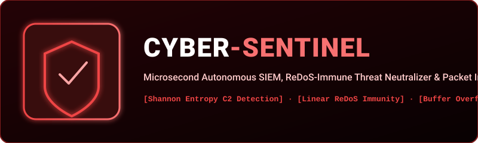

  

  
  
  
  

---

## 🛡️ What is CyberSentinel?

**CyberSentinel** is an ultra-fast, zero-dependency autonomous SIEM (Security Information & Event Management) and packet inspection engine designed to operate at line-rate in pure AAYU.

### Core Capabilities:
1. **Linear ReDoS-Immune Pattern Matching**: Immune to polynomial and exponential backtracking catastrophic attacks.
2. **Shannon Entropy C2 & Ransomware Detection**: Identifies heavily encrypted or compressed Command-and-Control payloads before execution.
3. **CIDR Subnet Resolution**: High-speed bitwise IP conversion and firewall subnet membership checks.
4. **Binary Exploit De Bruijn Cyclic Analyzer**: Pinpoints exact stack canary and return address offsets within intercepted crash dumps.

---

## 🏛️ System Architecture

`mermaid
flowchart TD
    RAW["Raw Network Ingestion / Socket Stream"] --> IP["CIDR Subnet Classifier"]
    IP -->|"Trusted IP Range"| PASS["Fast-Path Allow"]
    IP -->|"Untrusted / External"| INSP["Deep Packet Inspection (DPI)"]
    
    subgraph ThreatEngine["CyberSentinel Defense Pipeline"]
        INSP --> REDOS["ReDoS-Immune Signature Engine (SQLi / XSS / Path Traversal)"]
        INSP --> ENTROPY["Shannon Entropy Analyzer (C2 & Ransomware Payload)"]
        INSP --> DEBRUIJN["De Bruijn Offset Exploit Analyzer (Stack Canary Check)"]
    end

    REDOS -->|"Severity >= 8"| BLOCK["Automated IP Block & Packet Drop"]
    ENTROPY -->|"High Entropy"| QUARANTINE["Quarantine Encrypted Payload"]
    DEBRUIJN --> ALERT["Generate Forensics Incident Log"]
`

---

## 🔬 Live Execution Demonstration

`ash
aayu run examples/cyber_sentinel_siem.aayu
`

Output:
`
==================================================
   AAYU PROJECT 2: CYBER SENTINEL & SIEM ENGINE   
==================================================
[1] Registered 3 Linear ReDoS-Immune Attack Signatures
[2] Packet 1 (Normal Internal User):
    Source IP: 192.168.1.45 (Trusted Subnet: 1) -> Action: ALLOW
[3] Packet 2 (External SQL Injection Attack):
    Source IP: 203.0.113.88 (Trusted Subnet: 0)
    Threat Detected: SQL_INJECTION (Severity: 9/10) -> Action: DROP_AND_BLOCK_IP
[4] Packet 3 (High-Entropy Encrypted C2 Payload):
    Source IP: 198.51.100.22 -> Action: QUARANTINE_PAYLOAD
[5] Exploit Buffer Overflow Analysis:
    Intercepted Crash EIP: 'aaab' -> Exact Stack Canary Offset: 4 bytes
==================================================
   PROJECT 2: CYBER SENTINEL EXECUTION SUCCESS!   
==================================================
`

---

## 📄 License
MIT License (c) 2026 Ayush Kaushik ([@Ghrit-igl](https://github.com/Ghrit-igl)).